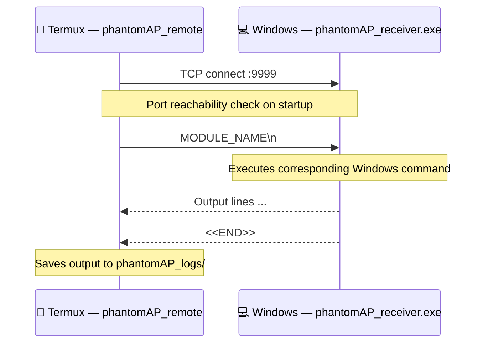
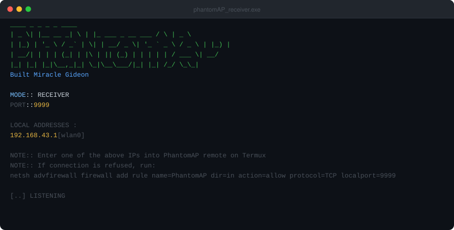
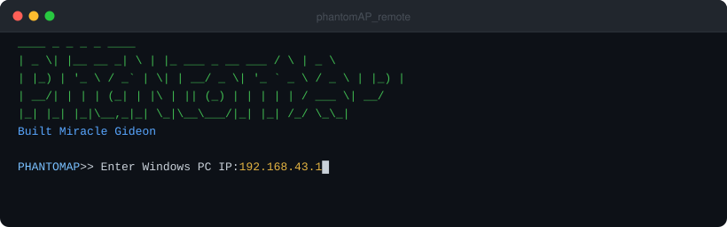
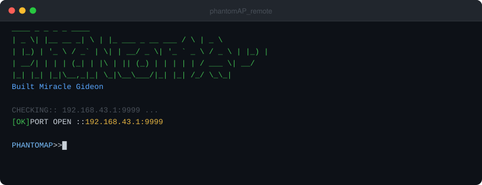
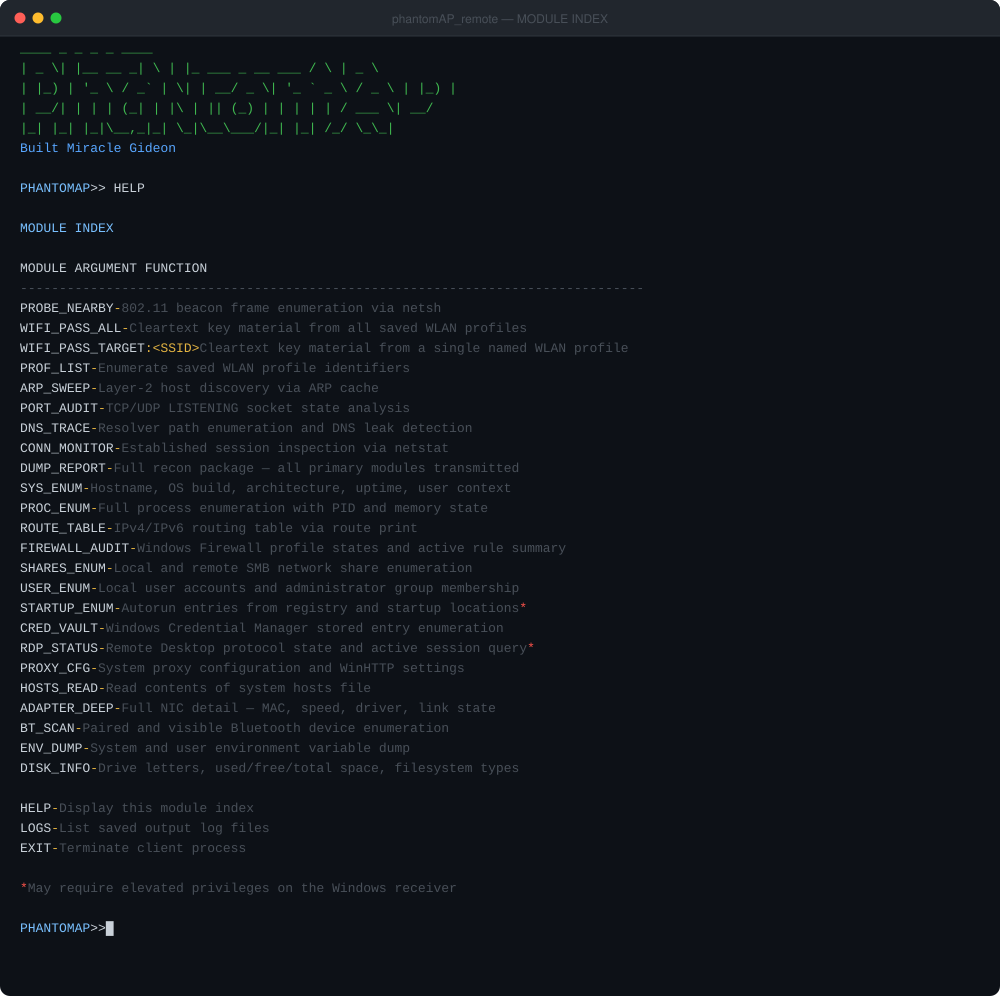
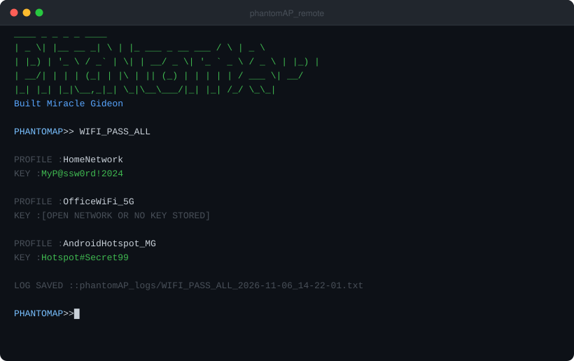

<p align="center">
<pre>
   ____  _           _   _                  _    ____
  |  _ \| |__   __ _| \ | |_ ___  _ __ ___ / \  |  _ \
  | |_) | '_ \ / _` |  \| | __/ _ \| '_ ` _ / _ \ | |_) |
  |  __/| | | | (_| | |\  | || (_) | | | | | / ___ \|  __/
  |_|   |_| |_|\__,_|_| \_|\__\___/|_| |_| /_/   \_\_|
</pre>
<em>Built Miracle Gideon</em>
</p>

<p align="center">
  
  
  
  
  
</p>

<p align="center">
  Remote Windows network intelligence toolkit operated from Termux over a local TCP connection.<br/>
  No internet. No cloud. No third-party services.
</p>

---

## How It Works



The remote client on Termux connects to the receiver on Windows over TCP port `9999`.
Each module request opens a fresh connection, sends a command string, reads the output
until the `<<END>>` sentinel, then closes. The receiver loops and immediately accepts
the next connection.

---

## Screenshots

### Receiver — Startup


### Remote Client — IP Prompt


### Remote Client — Live Session


### HELP Command Output


### WIFI\_PASS\_ALL Output


---

## Features

- **24 intelligence modules** — WiFi passwords, network hosts, processes, firewall, credentials, routes, and more
- **Command-name input** — type `WIFI_PASS_ALL`, not `2`
- **Case-insensitive** — `wifi_pass_all`, `WIFI_PASS_ALL`, and `Wifi_Pass_All` all work
- **Port check on startup** — the client refuses to open unless the receiver is actually reachable
- **Auto-save** — every module output is timestamped and saved to `phantomAP_logs/` automatically
- **HELP command** — full module index with arguments and descriptions, always available
- **LOGS command** — lists all saved log files with timestamps
- **Zero runtime dependencies** — both binaries are statically compiled; copy and run, nothing to install
- **Cross-compiled from Termux** — build both the Windows `.exe` and the Termux binary with one script
- **Thread-safe receiver** — handles concurrent connections with a mutex-protected console
- **Local network only** — all traffic stays on-device; nothing leaves your local subnet

---

## Requirements

| Component | Requirement |
|-----------|-------------|
| Build machine | Android device running Termux |
| Termux packages | `golang`, `unzip`, `git` |
| Windows receiver | Windows 10 / 11 — any edition, standard user |
| Go version | 1.21 or later |
| Network | Both devices on the same local network |

---

## Installation

Everything is built from Termux — including the Windows `.exe`.

### 1. Get the source

```bash
pkg install git
git clone https://github.com/YOUR_USERNAME/PhantomAP.git
cd PhantomAP
```

### 2. Build both binaries

```bash
bash build_all.sh
```

This script:
- Installs Go via `pkg` if not already present
- Cross-compiles `phantomAP_receiver.exe` for Windows x64
- Compiles `phantomAP_remote` for the current Termux device (Linux ARM64)

Output files after build:
```
phantomAP_receiver.exe   →  transfer this to the Windows PC
phantomAP_remote         →  run this on Termux
```

### 3. Transfer the receiver to Windows

Copy `phantomAP_receiver.exe` to the Windows PC via USB, WhatsApp, Telegram, or any file transfer method.

---

## Usage

### On Windows — start the receiver

Double-click `phantomAP_receiver.exe`. The window shows:
- The PhantomAP banner
- All local IP addresses with their interface names
- A listening status line

Note the IP address assigned on the network shared with your Termux device.

> **If connection is refused:** add a firewall exception from an elevated prompt:
> ```
> netsh advfirewall firewall add rule name=PhantomAP dir=in action=allow protocol=TCP localport=9999
> ```

### On Termux — start the remote client

```bash
./phantomAP_remote
```

Enter the Windows IP shown on the receiver screen. The client checks the port and opens the prompt if the receiver is reachable.

### Running modules

```
PHANTOMAP >> WIFI_PASS_ALL
PHANTOMAP >> wifi_pass_all          # same — case-insensitive
PHANTOMAP >> WIFI_PASS_TARGET:HomeNetwork
PHANTOMAP >> DUMP_REPORT
PHANTOMAP >> HELP
PHANTOMAP >> LOGS
PHANTOMAP >> EXIT
```

Output is printed to screen and saved automatically to `phantomAP_logs/MODULE_timestamp.txt`.

---

## Module Reference

| Module | Argument | Function | Needs Admin |
|--------|----------|----------|-------------|
| `PROBE_NEARBY` | — | 802.11 beacon frame enumeration via netsh | No |
| `WIFI_PASS_ALL` | — | Cleartext key material extraction from all saved WLAN profiles | No |
| `WIFI_PASS_TARGET` | `:<SSID>` | Cleartext key material from a single named WLAN profile | No |
| `PROF_LIST` | — | Enumerate saved WLAN profile identifiers | No |
| `ARP_SWEEP` | — | Layer-2 host discovery via ARP cache | No |
| `PORT_AUDIT` | — | TCP/UDP LISTENING socket state analysis | No |
| `DNS_TRACE` | — | Resolver path enumeration and DNS leak detection | No |
| `CONN_MONITOR` | — | Established session inspection via netstat | No |
| `DUMP_REPORT` | — | Full recon package — all primary modules transmitted | No |
| `SYS_ENUM` | — | Hostname, OS build, architecture, uptime, user context | No |
| `PROC_ENUM` | — | Full process enumeration with PID and memory state | No |
| `ROUTE_TABLE` | — | IPv4/IPv6 routing table via route print | No |
| `FIREWALL_AUDIT` | — | Windows Firewall profile states and active rule summary | No |
| `SHARES_ENUM` | — | Local and remote SMB network share enumeration | No |
| `USER_ENUM` | — | Local user accounts and administrator group membership | No |
| `STARTUP_ENUM` | — | Autorun entries from registry and startup locations | Yes `*` |
| `CRED_VAULT` | — | Windows Credential Manager stored entry enumeration | No |
| `RDP_STATUS` | — | Remote Desktop protocol state and active session query | Yes `*` |
| `PROXY_CFG` | — | System proxy configuration and WinHTTP settings | No |
| `HOSTS_READ` | — | Read contents of system hosts file | No |
| `ADAPTER_DEEP` | — | Full NIC detail — MAC, speed, driver, link state | No |
| `BT_SCAN` | — | Paired and visible Bluetooth device enumeration | No |
| `ENV_DUMP` | — | System and user environment variable dump | No |
| `DISK_INFO` | — | Drive letters, used/free/total space, filesystem types | No |

> `*` Modules marked **Yes** may return partial output or access errors without elevation.
> All other modules run fully as a standard Windows user.

---

## Repository Structure

```
PhantomAP/
├── receiver/
│   ├── go.mod
│   └── main.go              # Windows TCP listener — all module logic
├── remote/
│   ├── go.mod
│   └── main.go              # Termux client — prompt, port check, log saving
├── screenshots/             # Drop screenshots here — referenced in this README
├── .gitignore
├── LICENSE
├── README.md
├── build_all.sh             # Build both binaries from Termux
└── build_receiver.bat       # Windows fallback build script
```

---

## Pushing to GitHub

```bash
pkg install git
cd PhantomAP
git init
git add .
git commit -m "Initial commit — PhantomAP v2"
git branch -M main
git remote add origin https://github.com/YOUR_USERNAME/YOUR_REPO.git
git push -u origin main
```

---

## License

MIT © 2026 Miracle Gideon — see [LICENSE](LICENSE) for full terms.
